# SwiftTrack — System Diagrams

Visual companion to [system.md](system.md). All diagrams are [Mermaid](https://mermaid.js.org/)
and render on GitHub and in VS Code's Markdown preview (with a Mermaid extension).
Dashed arrows and grey nodes mark parts that are designed but not yet wired in the code.

1. [System context](#1-system-context)
2. [Containers and components](#2-containers-and-components)
3. [RabbitMQ topology](#3-rabbitmq-topology)
4. [Order placement — happy path](#4-order-placement--happy-path)
5. [Failure and compensation](#5-failure-and-compensation)
6. [Driver delivery and real-time push](#6-driver-delivery-and-real-time-push)
7. [Saga state machine](#7-saga-state-machine)
8. [Order status lifecycle](#8-order-status-lifecycle)
9. [Data model](#9-data-model)
10. [Frontend structure](#10-frontend-structure)
11. [Deployment](#11-deployment)
12. [Legacy adapters and protocols](#12-legacy-adapters-and-protocols)

---

## 1. System context

Who uses SwiftTrack and which external systems it integrates.

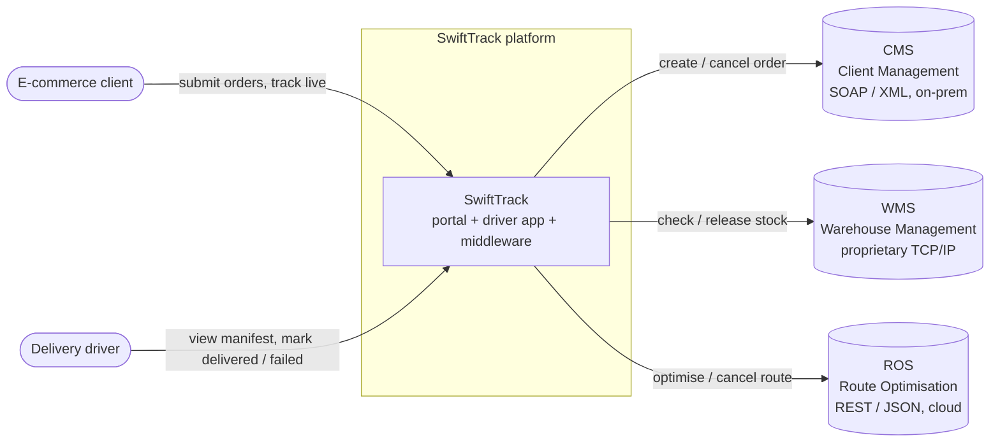

---

## 2. Containers and components

Every runtime part, its internal classes, and every connection between them.

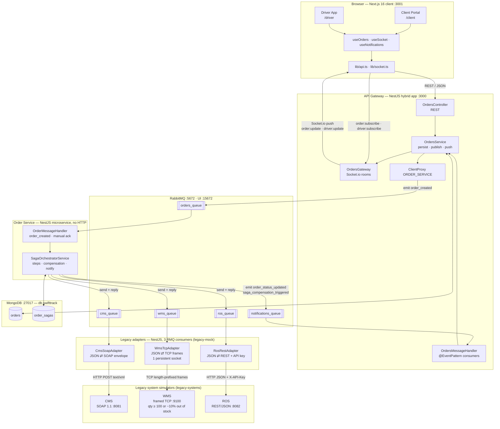

---

## 3. RabbitMQ topology

Producers, queues, consumers and the message patterns on each queue.
Solid = event (`emit`, fire-and-forget). Thick = command (`send`, request–reply).
Dashed = handler exists but nothing produces the message yet.

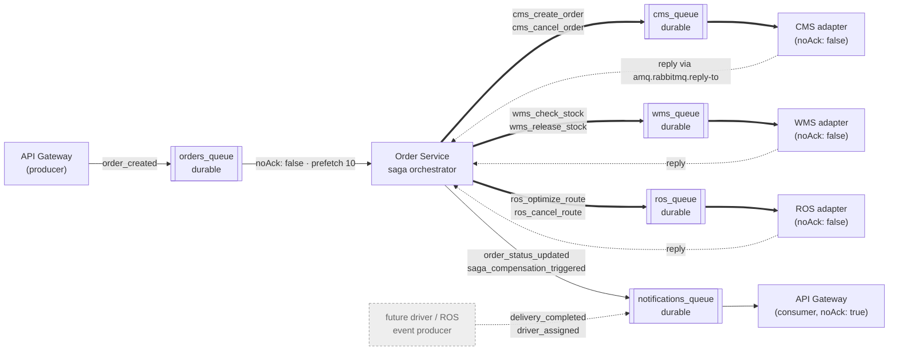

---

## 4. Order placement — happy path

From the client pressing **Submit** to the order appearing on the driver's manifest.

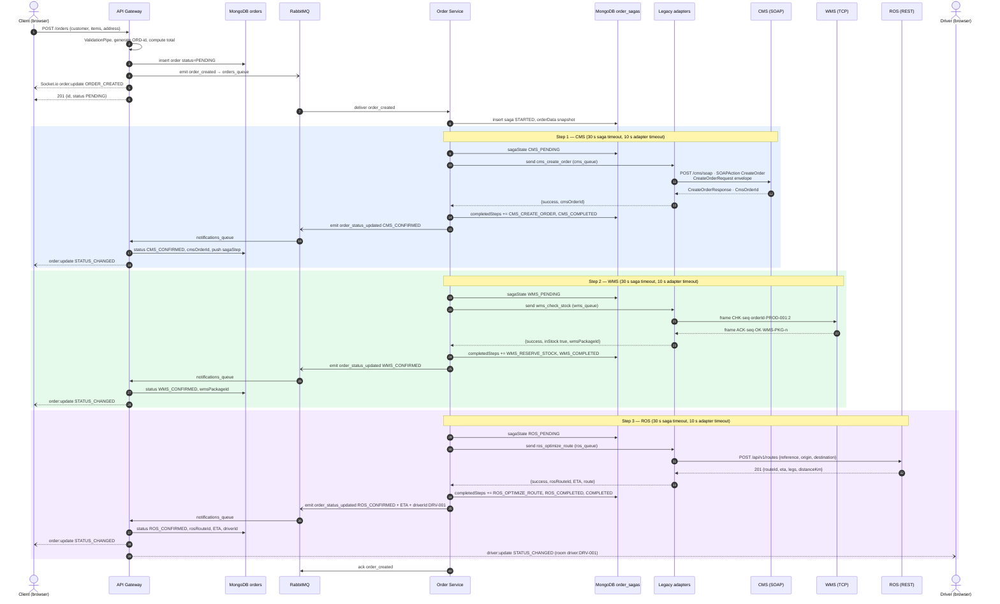

---

## 5. Failure and compensation

WMS reports out of stock after CMS has already created the order. The orchestrator
undoes only what is in `completedSteps`, in reverse order.

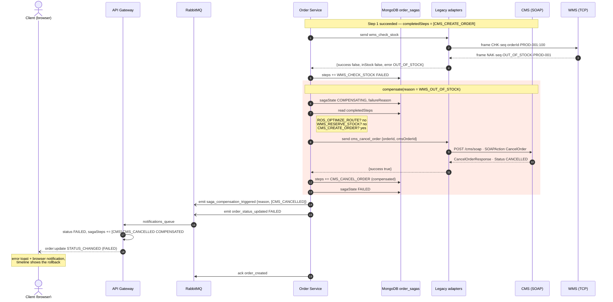

The same path is taken when a legacy system is unreachable or slow (the adapter returns
`CMS_UNAVAILABLE`, `WMS_TIMEOUT`, … within 10 s), when any `send()` times out after 30 s, or
when ROS fails. A cancel or release for something the system no longer holds
(`CMS_ORDER_NOT_FOUND`, WMS `NOT_FOUND`, ROS 404) counts as success. The general rule:

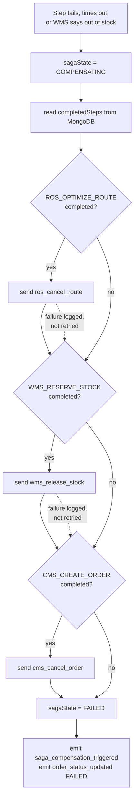

---

## 6. Driver delivery and real-time push

The driver marks a stop delivered; the client's screen updates immediately.
This path is REST → MongoDB → Socket.io inside the gateway and does not go through RabbitMQ.

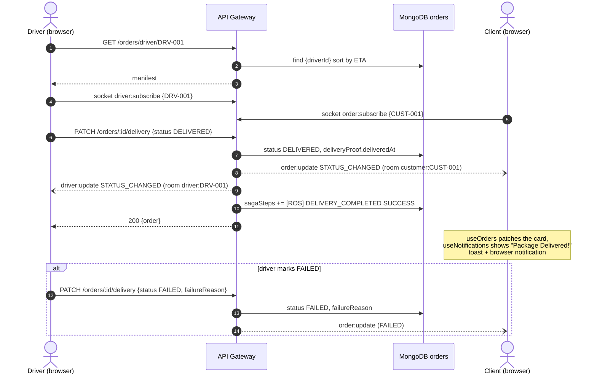

Generic path for any update coming from the saga:

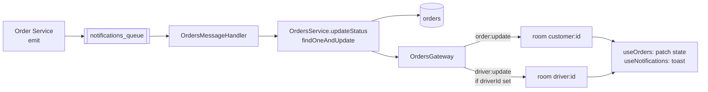

---

## 7. Saga state machine

`order_sagas.sagaState`, owned by the Order Service.

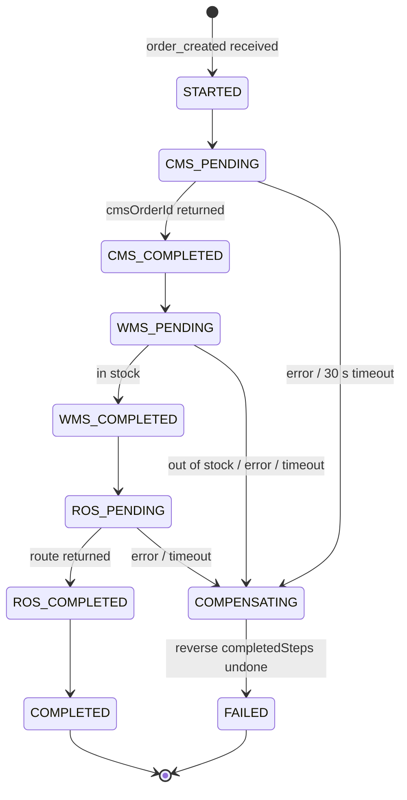

---

## 8. Order status lifecycle

`orders.status`, what clients and drivers see. Solid transitions are produced by the code
today; the states grouped under "Designed, not yet produced" are defined and handled by the UI,
but nothing sets them yet.

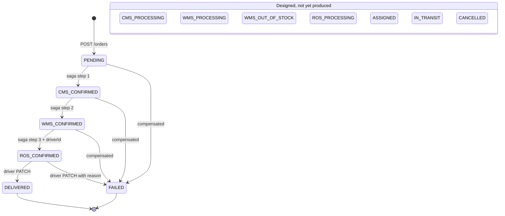

Intended full lifecycle once the gaps in [system.md §12](system.md#12-gaps-between-design-and-implementation) are closed:

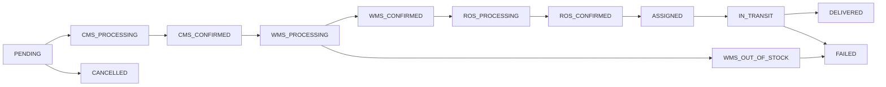

---

## 9. Data model

Two collections in one MongoDB database, each owned by one service. Arrays and sub-objects
are embedded, not referenced. `orders.id` and `order_sagas.orderId` hold the same value but
neither service reads the other's collection.

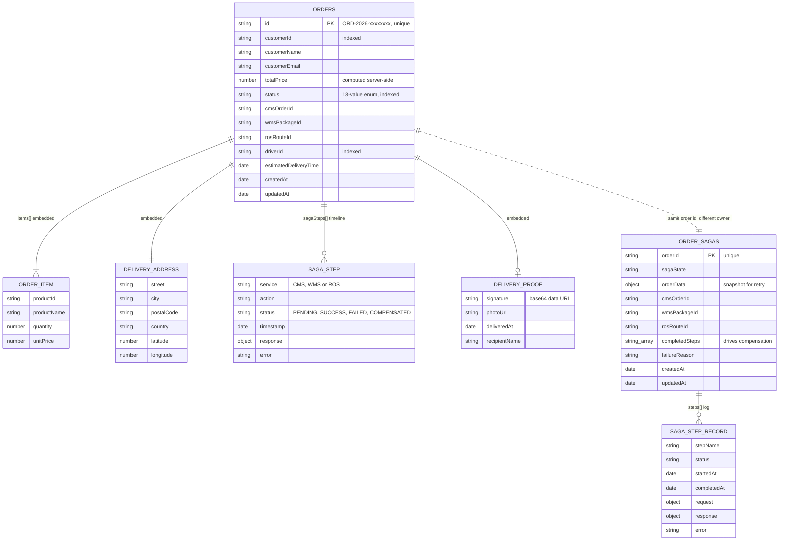

---

## 10. Frontend structure

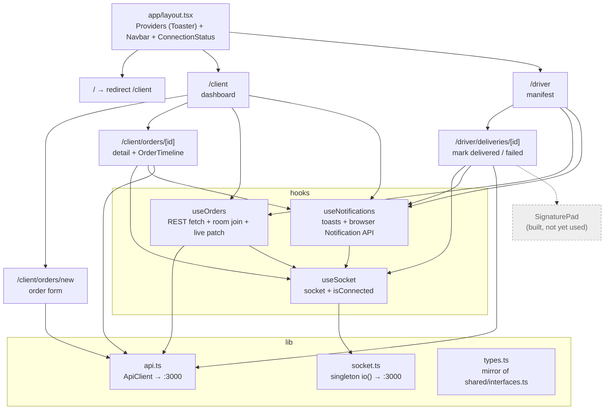

---

## 11. Deployment

`docker-compose.yml`: seven containers on one bridge network with two named volumes.

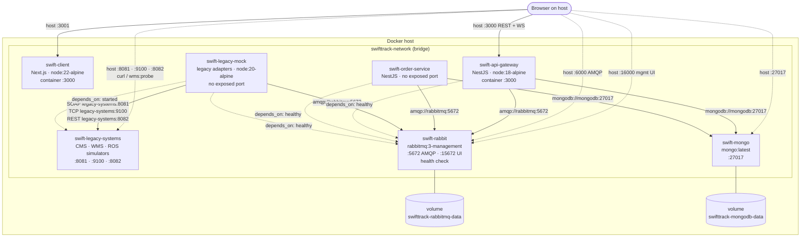

| Host port | Container | Purpose |
| --- | --- | --- |
| 3001 | `swift-client:3000` | Web app |
| 3000 | `swift-api-gateway:3000` | REST + Socket.io |
| 6000 | `swift-rabbit:5672` | AMQP (moved from 5672 to avoid Windows reserved ports) |
| 16000 | `swift-rabbit:15672` | RabbitMQ management UI |
| 27017 | `swift-mongo:27017` | MongoDB |
| 8081 | `swift-legacy-systems:8081` | CMS simulator, SOAP 1.1 (`POST /cms/soap`) |
| 9100 | `swift-legacy-systems:9100` | WMS simulator, length-prefixed TCP frames |
| 8082 | `swift-legacy-systems:8082` | ROS simulator, REST/JSON (`/api/v1/routes`) |

---

## 12. Legacy adapters and protocols

Each adapter consumes canonical JSON from its queue, translates it to the legacy system's own
protocol, calls the system, and translates the reply back. The orchestrator only ever sees the
canonical JSON. Code: [legacy-cms/src/adapters/](../legacy-cms/src/adapters/) (adapters),
[legacy-cms/src/protocols/](../legacy-cms/src/protocols/) (codecs),
[legacy-cms/src/systems/](../legacy-cms/src/systems/) (simulators).

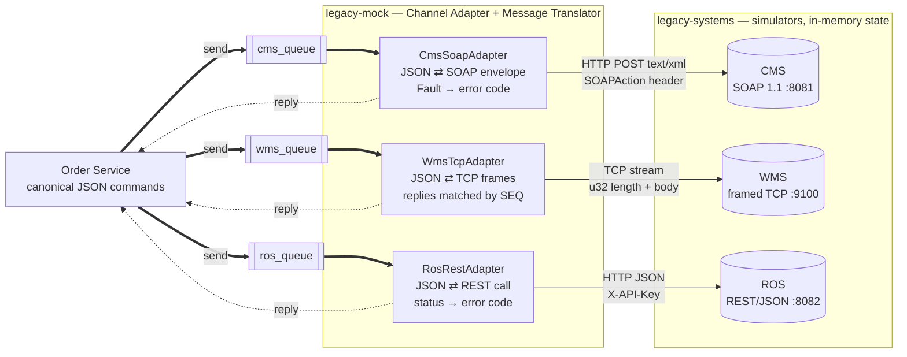

| System | Request | Success reply | Failure reply |
| --- | --- | --- | --- |
| CMS | `CreateOrderRequest` / `CancelOrderRequest` SOAP envelope | `CreateOrderResponse` with `CmsOrderId` | HTTP 500 `soapenv:Fault` with `<cms:ErrorCode>` |
| WMS | `CHK`, `RSV`, `REL`, `PNG` frames | `ACK·seq·OK·…` / `PON·seq` | `NAK·seq·OUT_OF_STOCK·sku`, `NOT_FOUND`, `BAD_REQUEST` |
| ROS | `POST /api/v1/routes`, `DELETE /api/v1/routes/:id` | 201 route JSON / 204 | 400, 401, 404, 5xx |

### WMS frame format

Every message in both directions is a 4-byte big-endian length followed by a UTF-8 body of
`|`-separated fields (shown as `·` in the diagrams above). Reserved characters inside fields
are escaped (`|` → `%7C`, `,` → `%2C`, `:` → `%3A`, `%` → `%25`).

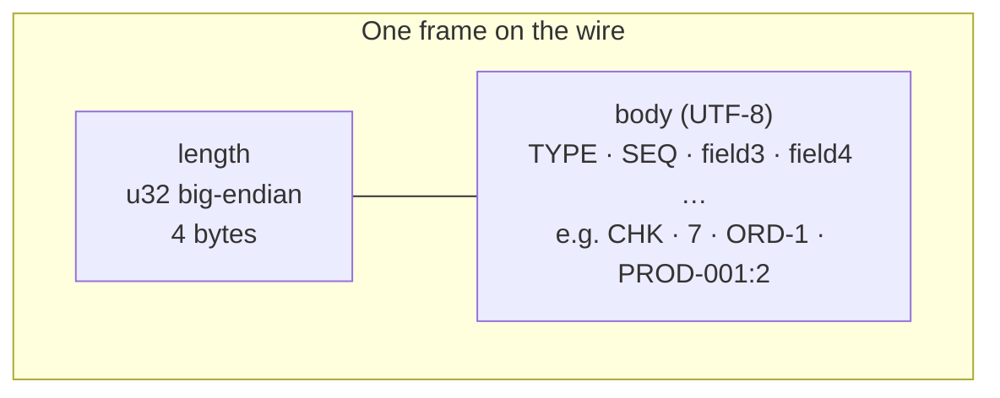

### WMS connection lifecycle

One TCP connection, opened on first use and shared by all requests. TCP has no message
boundaries, so a `FrameDecoder` reassembles frames that arrive split or merged.

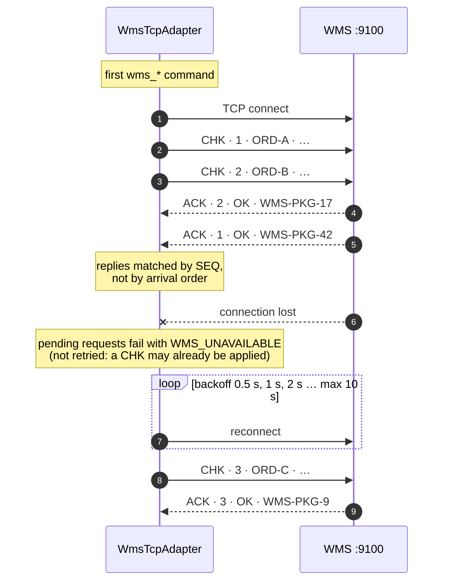

### Error mapping

Adapters never throw back to the saga. Every problem becomes `{ success: false, error }`, which
the saga already handles by compensating.

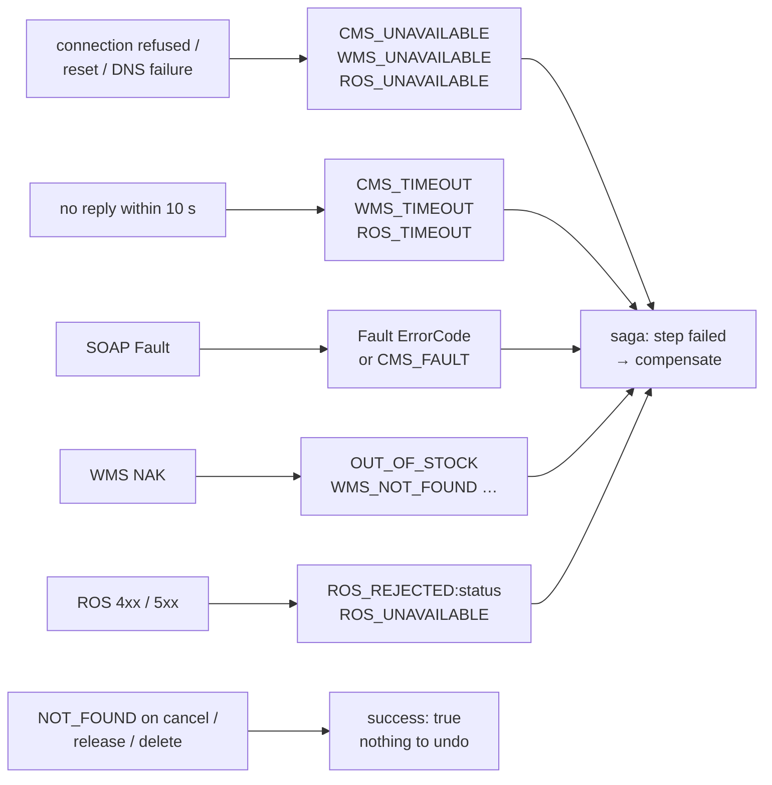
